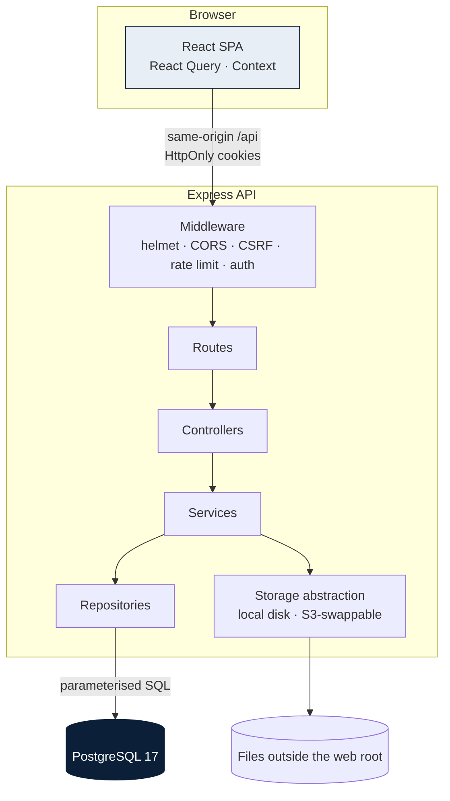

# Civic Connect — Smart Civic Issue Reporting and Resolution System

A full-stack web application for reporting, triaging and resolving civic
problems — potholes, broken streetlights, water leaks, uncollected refuse, open
manholes. Citizens report with a photograph and a location; administrators
triage and assign; field workers update progress and close the loop with
photographic evidence.

Built as a **UN SDG 11** (Sustainable Cities and Communities) project, but built
the way a small municipality, campus or resident welfare association would
actually need it: real database, real authentication, real authorisation, real
file handling. Nothing in the interface is a placeholder.

```
React 18 + TypeScript + Vite  ·  Node + Express + TypeScript  ·  PostgreSQL 17
No ORM · No MongoDB · No Firebase · Parameterised SQL only
```

---

## Contents

- [What it does](#what-it-does)
- [Screens](#screens)
- [Quick start](#quick-start)
- [Demo accounts](#demo-accounts)
- [Project layout](#project-layout)
- [Commands](#commands)
- [Testing](#testing)
- [API documentation](#api-documentation)
- [Architecture in brief](#architecture-in-brief)
- [Security in brief](#security-in-brief)
- [SDG 11](#sdg-11-sustainable-cities-and-communities)
- [Deployment notes](#deployment-notes)
- [Documentation](#documentation)

---

## What it does

**Citizens** report an issue through a four-step wizard: category and severity,
location (GPS or a dragged pin), description and photographs, then review. Before
submission the app checks for nearby recent reports of the same kind and offers
to show an existing one instead. Afterwards they track progress on a timeline,
comment, and either confirm the fix or reopen it with a reason.

**Administrators** work a priority-sorted queue. They review, reject with a
reason, override the calculated priority, assign to the least-loaded worker, and
watch a dashboard of live SQL aggregations — volume over time, category
breakdown, resolution times, geographic hotspots, per-worker workload. They
manage users, categories and departments, export CSV, and read an append-only
audit log.

**Field workers** get a queue of their assignments, mark work in progress, put
it on hold with a reason, upload proof of the repair and mark it resolved. The
server will not accept a resolution without a photograph.

**Anyone** can browse the public feed and map without an account — with reporter
identities removed and coordinates deliberately coarsened.

### Feature summary

| | |
| --- | --- |
| **Roles** | Citizen, Worker, Admin — enforced server-side, never in the UI alone |
| **Lifecycle** | 9 states, 20 legal transitions, validated by a server-side state machine |
| **Priority** | Calculated from category, citizen severity, corroborating reports and SLA age; overridable by an admin |
| **Duplicates** | Bounding-box + Haversine within 150 m over 7 days. No PostGIS required |
| **Uploads** | Magic-number validated, re-encoded, EXIF-stripped, stored outside the web root |
| **Analytics** | Every figure is a live SQL aggregation. No hardcoded numbers anywhere |
| **Audit** | Append-only log of every consequential action |
| **Notifications** | Written in the same transaction as the event that caused them |
| **Accessibility** | Semantic HTML, keyboard operable, WCAG AA contrast, status never by colour alone |

---

## Screens

Three role-specific dashboards plus public pages, all responsive from 320 px up.

| Public | Citizen | Worker | Admin |
| --- | --- | --- | --- |
| Landing | Dashboard | My assignments | Issue queue |
| About | Report wizard | Work history | Analytics |
| How it works | My issues | Issue detail | Workers |
| Community map | Issue detail | | Users |
| Public issue detail | Notifications | Notifications | Categories |
| Privacy | Profile | Profile | Audit log |

---

## Quick start

**Prerequisites:** Node.js 20+, PostgreSQL 14+ (17 recommended), npm 10+.

```bash
git clone <repository-url> civic-connect
cd civic-connect
```

### 1. Database

```bash
sudo -u postgres psql -c "CREATE ROLE civic LOGIN PASSWORD 'civic_dev_password';"
sudo -u postgres psql -c "CREATE DATABASE civic OWNER civic;"
```

<details>
<summary>Or with Docker Compose</summary>

```bash
docker compose up -d db
```

The compose file is a **development convenience** — weak credentials, no TLS.
It is not a deployment artefact. See [Deployment notes](#deployment-notes).
</details>

### 2. Backend

```bash
cd server
cp .env.example .env      # then edit: at minimum replace both secrets
npm install
npm run db:migrate        # 6 migrations
npm run db:seed           # demo data — refuses to run with NODE_ENV=production
npm run dev               # http://localhost:4000
```

Generate real secrets rather than using the placeholders:

```bash
node -e "console.log(require('crypto').randomBytes(48).toString('hex'))"
```

### 3. Frontend

```bash
cd ../client
cp .env.example .env
npm install
npm run dev               # http://localhost:5173
```

Open <http://localhost:5173>. The Vite dev server proxies `/api` to the backend,
so the browser only ever makes same-origin requests and the auth cookies stay
first-party.

### 4. Check it works

```bash
bash scripts/smoke-test.sh     # 131 assertions against the running API
```

---

## Demo accounts

Created by `npm run db:seed`. **Development only** — the seed script refuses to
run when `NODE_ENV=production`.

| Role | Email | Password |
| --- | --- | --- |
| Admin | `admin@civicconnect.dev` | `CivicDemo#2026` |
| Admin | `supervisor@civicconnect.dev` | `CivicDemo#2026` |
| Worker (roads) | `worker.roads@civicconnect.dev` | `CivicDemo#2026` |
| Worker (sanitation) | `worker.sanitation@civicconnect.dev` | `CivicDemo#2026` |
| Worker (water) | `worker.water@civicconnect.dev` | `CivicDemo#2026` |
| Worker (electrical) | `worker.electrical@civicconnect.dev` | `CivicDemo#2026` |
| Citizen | `citizen@civicconnect.dev` | `CivicDemo#2026` |
| Citizen | `arjun@civicconnect.dev` | `CivicDemo#2026` |
| Citizen | `fatima@civicconnect.dev` | `CivicDemo#2026` |
| Citizen | `vikram@civicconnect.dev` | `CivicDemo#2026` |

The seed creates 5 departments, 10 users and 12 issues spread across every
lifecycle state, so each dashboard has something meaningful in it immediately.

---

## Project layout

```
.
├── client/                     React + Vite SPA
│   └── src/
│       ├── api/                fetch wrapper: CSRF, single-flight refresh
│       ├── components/         shared UI, map, lists, timeline
│       ├── contexts/           AuthContext
│       ├── hooks/              React Query data hooks
│       ├── layouts/            app shell and public shell
│       ├── pages/              public · citizen · worker · admin
│       ├── styles/             design tokens and global CSS
│       └── test/               frontend tests
│
├── server/                     Express REST API
│   ├── src/
│   │   ├── config/             env schema, validated at startup
│   │   ├── db/                 pool, migrator, CLI, seed
│   │   ├── middleware/         auth, RBAC, CSRF, rate limits, uploads, errors
│   │   ├── modules/            feature slices (routes → controller → service → repository)
│   │   │   ├── auth/  users/  issues/  categories/  departments/
│   │   │   └── notifications/  analytics/  audit/  storage/
│   │   ├── routes/             root router, health, docs
│   │   └── utils/              errors, logger, http helpers
│   └── tests/                  backend tests
│
├── database/
│   └── migrations/             6 up + 6 down, plain SQL
│
├── docs/
│   ├── architecture.md         layering, auth design, decisions
│   ├── database.md             ER diagram, constraints, indexes
│   ├── api.md                  conventions and worked examples
│   ├── openapi.yaml            OpenAPI 3.0 — 60 operations
│   ├── security.md             threat model, OWASP review, limitations
│   └── user-flows.md           role journeys as diagrams
│
├── scripts/smoke-test.sh       131-assertion end-to-end check
└── docker-compose.yml          development database + services
```

Backend layering is strict: **routes → controllers → services → repositories →
PostgreSQL**. Only repositories write SQL; only services own transactions and
business rules; controllers translate HTTP to and from those services.

---

## Commands

### Server (`cd server`)

| Command | What it does |
| --- | --- |
| `npm run dev` | Watch-mode API on port 4000 |
| `npm run build` | Compile TypeScript to `dist/` |
| `npm start` | Run the compiled build |
| `npm run typecheck` | `tsc --noEmit` |
| `npm run lint` | ESLint over `src` and `tests` |
| `npm test` | Backend test suite |
| `npm run test:watch` | Tests in watch mode |
| `npm run db:migrate` | Apply pending migrations |
| `npm run db:rollback` | Roll back the last migration (`-- 3` for three) |
| `npm run db:status` | Show applied and pending migrations |
| `npm run db:reset` | Roll everything back and re-apply |
| `npm run db:seed` | Load demo data (blocked in production) |

### Client (`cd client`)

| Command | What it does |
| --- | --- |
| `npm run dev` | Vite dev server on port 5173 |
| `npm run build` | Type-check and build to `dist/` |
| `npm run preview` | Serve the production build locally |
| `npm run typecheck` | `tsc --noEmit` |
| `npm run lint` | ESLint |
| `npm test` | Frontend test suite |

---

## Testing

```
Backend    179 tests   8 files
Frontend    78 tests   3 files
Smoke      131 assertions, end to end
─────────────────────────────────────
Total      388 checks
```

```bash
cd server && npm test        # 179 passing
cd client && npm test        #  78 passing
bash scripts/smoke-test.sh   # 131 passing (needs the API running)
```

The tests target the things that would actually hurt if they broke, not
line coverage:

| File | What it protects |
| --- | --- |
| `server/tests/auth.test.ts` | Registration, login, refresh rotation, reuse detection, CSRF, session revocation |
| `server/tests/rbac.test.ts` | Role guards, IDOR, 404-not-403, list scoping, privacy projection |
| `server/tests/lifecycle.test.ts` | Illegal transitions, reason and evidence gates, assignment atomicity, reopen-and-reassign |
| `server/tests/validation.test.ts` | Schema validation, SQL injection payloads, pagination ceiling, sort whitelist, error envelope, headers, CORS |
| `server/tests/uploads.test.ts` | Fake images, double extensions, SVG, oversized files, path traversal, authorised delivery |
| `server/tests/rateLimit.test.ts` | Limiter behaviour and configuration |
| `server/tests/analytics.test.ts` | Figures checked against direct SQL, viewer scoping, duplicate detection, priority engine |
| `server/tests/stateMachine.test.ts` | Transition table integrity as pure unit tests |
| `client/src/test/apiClient.test.ts` | CSRF echoing, **no localStorage**, single-flight refresh, error normalisation |
| `client/src/test/components.test.tsx` | Accessible names, aria wiring, keyboard interaction, empty and error states |
| `client/src/test/format.test.ts` | Formatting edge cases — nulls, invalid dates, pluralisation |

Backend tests run against a real PostgreSQL database, not mocks. Each run tags
its rows with a unique id and cleans up afterwards, so the suite is repeatable
against a development database.

---

## API documentation

With the server running:

| | |
| --- | --- |
| **Swagger UI** | <http://localhost:4000/docs> |
| **OpenAPI YAML** | <http://localhost:4000/docs/openapi.yaml> |
| **OpenAPI JSON** | <http://localhost:4000/docs/openapi.json> |

The specification lives at [`docs/openapi.yaml`](docs/openapi.yaml) and covers
all **60 operations**. It is served from that file rather than duplicated in
code, so the two cannot drift.

Conventions, error codes and worked `curl` examples are in
[`docs/api.md`](docs/api.md).

Every response uses the same envelope:

```jsonc
{ "success": true,  "data": { … } }
{ "success": true,  "data": [ … ], "pagination": { "page": 1, "limit": 20, "total": 137, "totalPages": 7 } }
{ "success": false, "error": { "code": "VALIDATION_ERROR", "message": "…", "details": [ … ], "requestId": "…" } }
```

---

## Architecture in brief



Decisions worth knowing, each explained in
[`docs/architecture.md`](docs/architecture.md):

- **No ORM.** Explicit SQL with `pg`. The queries here — aggregations, window
  functions, partial unique indexes, generated `tsvector` columns — are the
  interesting part of the system, and an ORM would obscure them while adding a
  layer to debug. Every query is parameterised.
- **No PostGIS.** Duplicate detection uses a bounding-box prefilter plus
  Haversine in SQL, which is accurate at neighbourhood scale and runs on any
  stock PostgreSQL. Requiring an extension would make the project harder to run
  for no benefit at this size.
- **AI is optional.** `ai.classifier.ts` is an interface with a local
  rule-based implementation. The app is fully functional with no external
  service, no API key and no network egress.
- **Context + React Query, not Redux.** Server state belongs to React Query;
  auth state is a small context; UI state is local. Redux would add ceremony
  without solving a problem this app has.
- **Soft deletion.** Issues get `deleted_at`; categories and departments get
  `is_active`. History and audit rows are never cascade-deleted, because the
  point of an audit trail is that it survives.

---

## Security in brief

Full detail, including the OWASP Top 10 review and an honest list of
limitations, is in [`docs/security.md`](docs/security.md).

- **Argon2id** password hashing at OWASP-recommended parameters.
- **HttpOnly cookies only.** Nothing is ever stored in `localStorage`; a
  frontend test asserts it.
- **15-minute access token**, 30-day rotating refresh token stored as a SHA-256
  hash, with **reuse detection** that revokes the whole token family.
- **Three-layer CSRF**: `SameSite=Lax`, a double-submit token compared in
  constant time, and an `Origin` allowlist. The code explicitly documents why
  *"CORS prevents CSRF"* is false.
- **Two-stage authorisation**: role middleware on the route, ownership checks in
  the service. Unauthorised object access returns **404, not 403**.
- **Parameterised SQL** everywhere; sort columns whitelisted because a column
  name cannot be a bound parameter.
- **Uploads** validated by magic number, re-encoded, EXIF-stripped, given
  server-generated names, stored outside the web root and served only through an
  authorised route.
- **Structured logging** with a redaction list; a request id ties a user's
  complaint to a log line without leaking anything.

---

## SDG 11: Sustainable Cities and Communities

> **Target 11.3** — *"enhance inclusive and sustainable urbanization and capacity
> for participatory, integrated and sustainable human settlement planning and
> management in all countries."*
> **Target 11.7** — *"provide universal access to safe, inclusive and accessible,
> green and public spaces."*

Local infrastructure problems are usually visible to residents long before they
reach the people responsible for fixing them. The gap is rarely goodwill; it is
that reporting is awkward, reports disappear into a queue with no acknowledgement,
and nobody can see whether anything happened. That gap is what this project
addresses.

**How the design connects to those targets**

*Participatory management (11.3).* Reporting takes a photograph, a pin and a
sentence. The reporter gets a quotable reference number, a visible status
timeline, and the final say — an issue is only closed when the person who
reported it confirms the fix, or an admin does so explicitly. Duplicate detection
turns "five people complained about the same pothole" from noise into evidence of
severity.

*Accessible public space (11.7).* The categories are weighted towards hazards
that make public space unusable or unsafe — open manholes carry the highest
default priority with a 6-hour SLA; damaged footpaths, broken streetlights and
blocked drainage are treated as safety issues rather than cosmetic ones. The
interface itself is built to WCAG AA: keyboard operable, screen-reader labelled,
legible in greyscale, and usable on a small phone, because a tool for reporting
accessibility problems that is itself inaccessible would be self-defeating.

*Accountability.* Status history and the audit log are append-only. Resolution
requires photographic evidence, so "marked as fixed" and "fixed" cannot quietly
diverge. The analytics are live SQL over real rows — average and median
resolution time, per-category backlog, geographic hotspots, per-worker load — the
figures a council would need to argue for budget, and the same figures a resident
could use to ask why their neighbourhood is slower than the next one.

*Privacy as a precondition for participation.* People report problems near where
they live. The public feed carries no reporter identity and rounds coordinates
to roughly 110 metres, which is enough to show a neighbourhood problem and not
enough to identify a doorstep. Photographs are stripped of EXIF, so a phone's
GPS tags and device identifiers never reach the server's stored copy.

**What this project is and is not**

It is a working system that a small municipality, a campus or a residents'
association could pilot after the hardening steps in
[`docs/security.md`](docs/security.md). It is not a claim to have solved urban
governance. Software does not fill a pothole; a crew with a budget does. What
this can plausibly do is shorten the distance between noticing a problem and the
right person knowing about it, and make the resulting record hard to lose. Any
measurable impact would depend entirely on a real municipality adopting it,
resourcing the crews, and being willing to be measured — none of which is in the
gift of the code.

---

## Deployment notes

**The Docker Compose file is for development.** Weak credentials, no TLS, no
resource limits, no backups. Do not point it at the internet and call it
production.

Before a real deployment, at minimum:

1. Replace every secret with freshly generated high-entropy values, held in a
   secrets manager rather than a `.env` file.
2. Set `NODE_ENV=production` — this turns on `Secure` cookies and HSTS — and
   terminate TLS at a reverse proxy that serves the SPA and the API under one
   origin.
3. Swap the storage implementation to S3 or equivalent. The interface already
   exists for this; local disk does not survive a container restart and does not
   scale past one instance.
4. Move rate limiting to shared state (Redis) or the edge; in-memory limits
   become per-instance as soon as you run two.
5. Configure real email delivery for password reset.
6. Set up database TLS, least-privilege roles, backups and tested restores.
7. Add MFA for admin accounts, dependency scanning, log aggregation and
   alerting.

The full list, with reasoning, is at the end of
[`docs/security.md`](docs/security.md).

---

## Documentation

| Document | Contents |
| --- | --- |
| [docs/architecture.md](docs/architecture.md) | Layering, auth design, state machine, storage abstraction, the reasoning behind each major decision |
| [docs/database.md](docs/database.md) | ER diagram, every table and constraint, index choices, migration list |
| [docs/api.md](docs/api.md) | Conventions, error codes, pagination, worked `curl` examples |
| [docs/openapi.yaml](docs/openapi.yaml) | OpenAPI 3.0 specification, 60 operations |
| [docs/security.md](docs/security.md) | Threat model, every control, OWASP Top 10 review, known limitations |
| [docs/user-flows.md](docs/user-flows.md) | Role journeys, sequence and state diagrams, accessibility notes |
| [docs/checklist.md](docs/checklist.md) | Point-by-point verification of all 70 requirements, with evidence and explicit non-claims |

---

## Licence

MIT.
