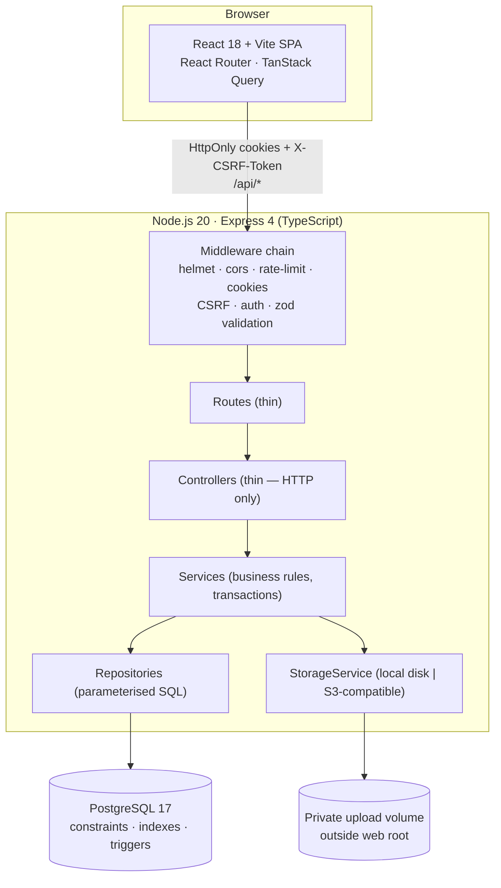
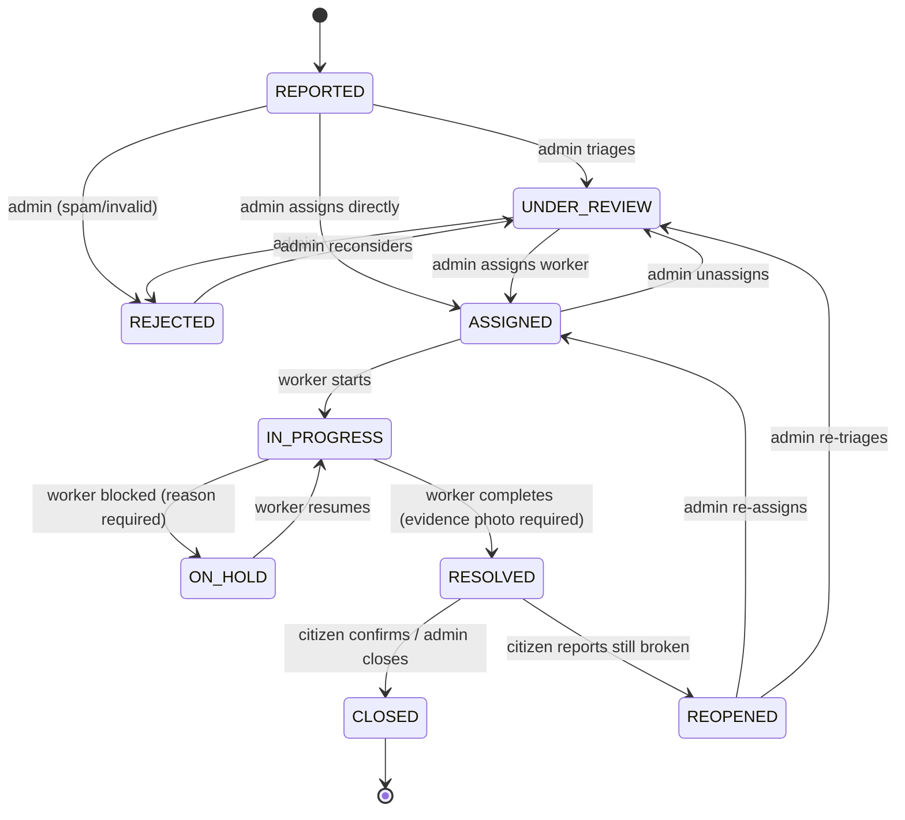

# Architecture — Smart Civic Issue Reporting and Resolution System

## 1. Overview

A three-tier web application: a React SPA, an Express REST API, and a PostgreSQL
database. The API is the single source of truth for authentication, authorization
and business rules. The client is treated as **untrusted**: every rule enforced in
the UI is re-enforced on the server.



## 2. Layering rules

| Layer | Responsibility | May not do |
|---|---|---|
| **Route** | Bind path + middleware to a controller method | Contain logic |
| **Controller** | Parse validated input, call service, shape HTTP response | Touch SQL, decide business rules |
| **Service** | Business rules, state machine, transactions, notifications, audit | Know about `req`/`res` |
| **Repository** | Parameterised SQL, row → domain mapping | Contain business rules |

A service that mutates several tables opens **one transaction** and passes the
client down to every repository call so the write is atomic (§35 of the spec).

## 3. Authentication design

**Chosen approach: short-lived JWT access token + rotating opaque refresh token,
both in `HttpOnly` cookies.**

- **Access token** — JWT, 15 minutes, `HttpOnly; SameSite=Lax; Secure` (prod),
  path `/`. Contains `sub`, `role`, `tokenVersion`, `sid`. Never in `localStorage`.
- **Refresh token** — 128 bits of CSPRNG randomness, **SHA-256 hashed at rest**
  in `refresh_tokens`. 30-day lifetime, `HttpOnly`, path `/api/auth`.
  **Rotated on every refresh.** Re-use of a consumed token is treated as theft:
  the whole token family is revoked (`reuse_detected`).
- **Session invalidation** — `users.token_version` is embedded in the JWT. Bumping
  it (logout-all, password change, deactivation, role change) invalidates every
  outstanding access token immediately, without a per-request DB lookup for the
  common path.
- **Deactivation** — checked at refresh time and on every privileged action.

```mermaid
sequenceDiagram
    participant C as Client
    participant A as API
    participant D as PostgreSQL

    C->>A: POST /api/auth/login {email, password}
    A->>D: SELECT user by email (parameterised)
    A->>A: argon2id verify (dummy hash if user absent → constant-ish time)
    A->>D: INSERT refresh_tokens (sha256 hash, family, expires)
    A-->>C: Set-Cookie access_token (15m, HttpOnly)<br/>Set-Cookie refresh_token (30d, HttpOnly, /api/auth)<br/>Set-Cookie csrf_token (readable, 30d)
    Note over C,A: Access expires
    C->>A: POST /api/auth/refresh (cookie + X-CSRF-Token)
    A->>D: Look up hash; if already used → revoke family
    A->>D: Rotate: revoke old, insert new
    A-->>C: New cookie pair
```

### CSRF strategy (explicit — §14)

Cookie auth means CSRF must be addressed directly. Three independent layers:

1. **`SameSite=Lax`** on auth cookies — blocks cross-site `POST` form attacks.
2. **Double-submit CSRF token** — a random value is set in a *readable*
   `csrf_token` cookie; the SPA echoes it in the `X-CSRF-Token` header. The server
   compares the two with `timingSafeEqual` on **every** state-changing request
   (`POST/PUT/PATCH/DELETE`). An attacker on another origin cannot read the cookie
   to forge the header.
3. **Origin/Referer allowlist** — state-changing requests whose `Origin` is present
   but not in `CORS_ORIGIN` are rejected before reaching the handler.

"CORS prevents CSRF" is *false* and is not relied upon anywhere.

## 4. Authorization model (RBAC + object-level)

Three roles: `CITIZEN`, `WORKER`, `ADMIN`.

Route-level `requireRole(...)` is only the **first** gate. Every issue-scoped
endpoint additionally resolves an **access decision** for the specific row
(`issue.service.assertCanView` / `assertCanMutate`), which is how IDOR is
prevented:

| Actor | Can read issue | Can comment | Can change status |
|---|---|---|---|
| Reporter | always (own) | yes (public comments) | only `RESOLVED→CLOSED` (confirm) / `RESOLVED→REOPENED` |
| Any citizen | only if `is_public` **and** not deleted | no | no |
| Worker | only if actively assigned | yes (internal + public) | `ASSIGNED→IN_PROGRESS→ON_HOLD/RESOLVED` |
| Admin | all | yes | any transition permitted by the state machine |

Reporter contact details (email/phone) are stripped from every payload unless the
viewer is an admin — enforced in the repository projection, not the UI.

## 5. Issue lifecycle (state machine)

The transition table lives in `modules/issues/issue.state.ts` and is the **only**
place a status may change. Any transition not in the table is rejected with
`INVALID_TRANSITION` (409).



Every accepted transition writes an `issue_status_history` row **inside the same
transaction** as the status update, plus notifications and (for privileged
actions) an audit-log entry.

## 6. Storage abstraction

`StorageService` is an interface (`put`, `get`, `delete`, `exists`). The shipped
implementation is `LocalDiskStorage`, writing to a directory **outside the served
tree** with server-generated UUID keys in date-sharded folders. Files are never
served statically: `GET /api/issues/:id/images/:imageId` re-checks authorization,
then streams bytes with `Content-Disposition: inline`, `X-Content-Type-Options:
nosniff` and a locked-down CSP. Swapping in S3 means writing one new class.

Uploads are **re-encoded with sharp** rather than trusted: this validates that the
bytes really are a decodable raster image, strips EXIF (including GPS), caps
dimensions, and produces a known-safe JPEG/PNG/WebP. SVG is rejected outright.

## 7. Extension points

| Future feature | Hook that already exists |
|---|---|
| AI image classification | `AiClassifier` interface; `NullClassifier` active when unconfigured |
| AI priority prediction | `priority.service.ts` — rule engine behind one function |
| Email / SMS / push | `Notifier` interface; `ConsoleEmailNotifier` in dev |
| S3 object storage | `StorageService` interface |
| PostGIS | Distance is an isolated SQL expression in `issue.repository.ts` |
| Departments / SLA | `departments` table + `category.department_id` already modelled |

## 8. Why no ORM, why no PostGIS

**No ORM** — the spec requires explicit SQL. All queries are hand-written and
parameterised (`$1, $2 …`); no string interpolation of user input anywhere.
Sort/filter fields are resolved through **whitelist maps**, never concatenated.

**No PostGIS** — duplicate detection needs "issues of the same category within
~150 m reported in the last 7 days". A bounding-box prefilter on indexed
`latitude`/`longitude` columns followed by an exact Haversine computation in SQL
is accurate to well under a metre at city scale, costs nothing to install, and
keeps `docker compose up` working on stock `postgres:17-alpine`. PostGIS would
only pay off with polygon/ward geometry or millions of rows — documented as a
future step rather than a hard dependency.
