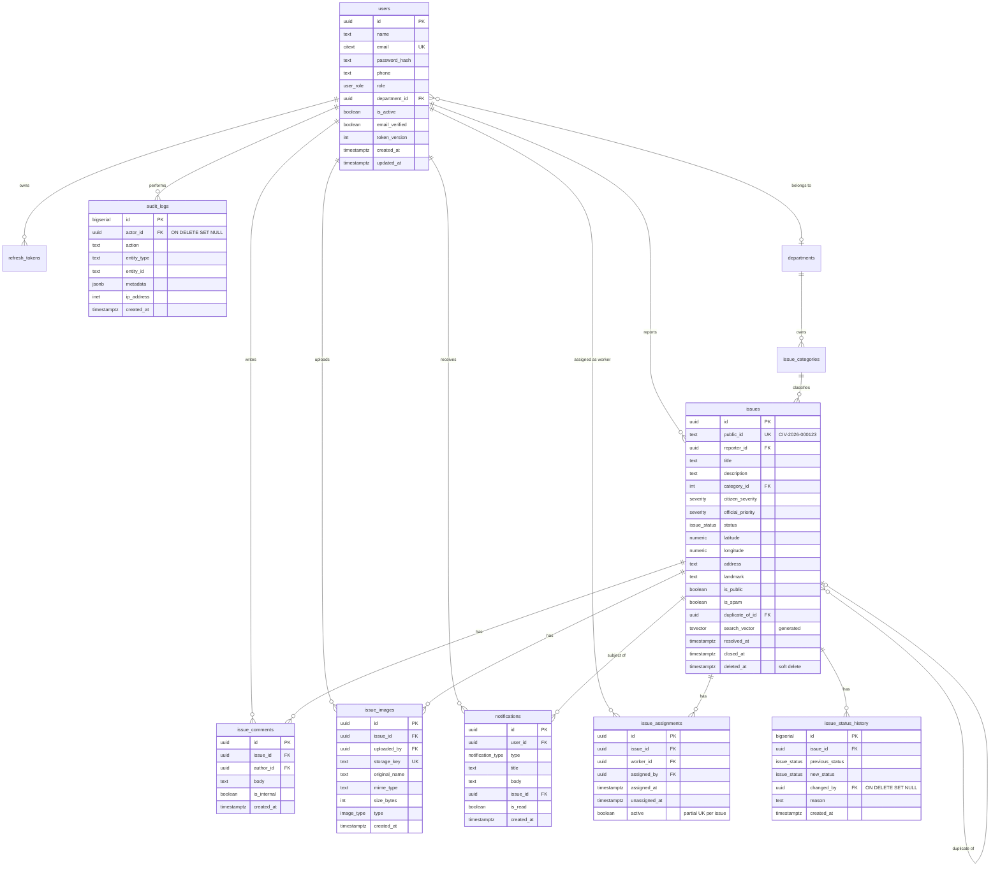

# Database Design

PostgreSQL 17. Migrations are plain SQL, applied in filename order by a small
runner (`server/src/db/migrator.ts`) that records applied versions in
`schema_migrations` and wraps **each migration in its own transaction**.

## ER diagram



## Enumerated types

Postgres `ENUM`s give database-level validity, not just application-level:

| Type | Values |
|---|---|
| `user_role` | `CITIZEN`, `WORKER`, `ADMIN` |
| `severity` | `LOW`, `MEDIUM`, `HIGH`, `CRITICAL` |
| `issue_status` | `REPORTED`, `UNDER_REVIEW`, `ASSIGNED`, `IN_PROGRESS`, `ON_HOLD`, `RESOLVED`, `REOPENED`, `CLOSED`, `REJECTED` |
| `image_type` | `REPORT`, `RESOLUTION`, `ADDITIONAL` |
| `notification_type` | `ISSUE_SUBMITTED`, `STATUS_CHANGED`, `ISSUE_ASSIGNED`, … |

## Key integrity decisions

**Public identifiers.** Primary keys are UUIDv4 (`gen_random_uuid()` from
`pgcrypto`), so nothing sequential is exposed. Issues additionally carry a
human-quotable `public_id` (`CIV-2026-000123`) generated by a Postgres sequence —
readable on a phone call, still not an enumerable primary key.

**One active assignment per issue.** Enforced by a *partial* unique index, not by
application code — this is what makes the two-admins-assign-simultaneously race
(§36) safe:

```sql
CREATE UNIQUE INDEX uq_issue_active_assignment
    ON issue_assignments (issue_id) WHERE active;
```

The losing transaction gets a `23505` unique violation, which the service layer
translates into a `409 CONFLICT`. Assignment also takes a `SELECT … FOR UPDATE`
row lock on the issue so status/history/assignment stay consistent.

**Cascade policy (deliberately mixed).**

- `ON DELETE CASCADE` — data meaningless without its parent: `issue_images`,
  `issue_comments`, `refresh_tokens`.
- `ON DELETE SET NULL` — audit/history that must survive: `issue_status_history.changed_by`,
  `audit_logs.actor_id`. Deleting a user must never erase the record of what they did.
- `ON DELETE RESTRICT` — `issues.category_id`. A category in use cannot be deleted;
  admins deactivate it instead (`is_active = false`).

Issues are **soft-deleted** (`deleted_at`) so history and analytics stay intact;
every read path filters `deleted_at IS NULL`.

**Check constraints.** Latitude `-90..90`, longitude `-180..180`, title length
5–150, description 10–5000, non-empty names, and a cross-field guard that
`status='RESOLVED'` implies `resolved_at IS NOT NULL`.

**Timestamps.** All `timestamptz`. `updated_at` is maintained by a shared
`set_updated_at()` trigger, so the application cannot forget it.

## Indexes and why each exists

| Index | Justification |
|---|---|
| `issues (status) WHERE deleted_at IS NULL` | Dashboard/status filters — partial keeps it small |
| `issues (category_id)`, `issues (reporter_id)` | FK filters ("my issues", category analytics) |
| `issues (created_at DESC)` | Default list ordering + time-series analytics |
| `issues (official_priority, created_at DESC)` | Composite: the admin triage queue sorts by priority then recency |
| `issues (status, category_id) WHERE deleted_at IS NULL` | Composite for the common combined filter |
| `issues (latitude, longitude)` | Bounding-box prefilter for duplicate detection & map |
| `issues USING GIN (search_vector)` | Full-text search over title+description |
| `issue_assignments (worker_id) WHERE active` | Worker dashboard — the hot query |
| `notifications (user_id, is_read, created_at DESC)` | Unread badge + notification list |
| `refresh_tokens (token_hash)` | Refresh lookup by hash |
| `audit_logs (created_at DESC)`, `(entity_type, entity_id)` | Audit browsing and per-entity trails |

Indexes deliberately **not** created: `users.name`, `issues.landmark`,
`issue_comments.body` — never filtered on, and every index costs write throughput.

## Full-text search

`issues.search_vector` is a **generated stored column**:

```sql
search_vector tsvector GENERATED ALWAYS AS (
    setweight(to_tsvector('english', coalesce(title, '')), 'A') ||
    setweight(to_tsvector('english', coalesce(description, '')), 'B') ||
    setweight(to_tsvector('english', coalesce(public_id, '')), 'A')
) STORED
```

It cannot drift from the row, needs no trigger, and is GIN-indexed. Queries use
`websearch_to_tsquery('english', $1)`, which accepts human input safely and never
requires string concatenation. Short/ID-like searches fall back to a bounded
prefix match on `public_id`.

## Migrations

| File | Contents |
|---|---|
| `001_extensions_and_enums.sql` | `pgcrypto`, `citext`, all enums, `set_updated_at()` |
| `002_users_and_auth.sql` | `departments`, `users`, `refresh_tokens`, `password_reset_tokens`, `email_verification_tokens` |
| `003_categories.sql` | `issue_categories` + the nine seeded civic categories |
| `004_issues.sql` | `issues`, `public_id` sequence + default, search vector, indexes |
| `005_issue_children.sql` | `issue_images`, `issue_comments`, `issue_status_history`, `issue_assignments` |
| `006_notifications_and_audit.sql` | `notifications`, `audit_logs` |

Each file has a matching `*.down.sql` for `npm run db:rollback`.
