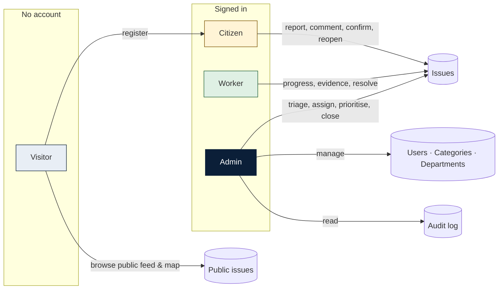
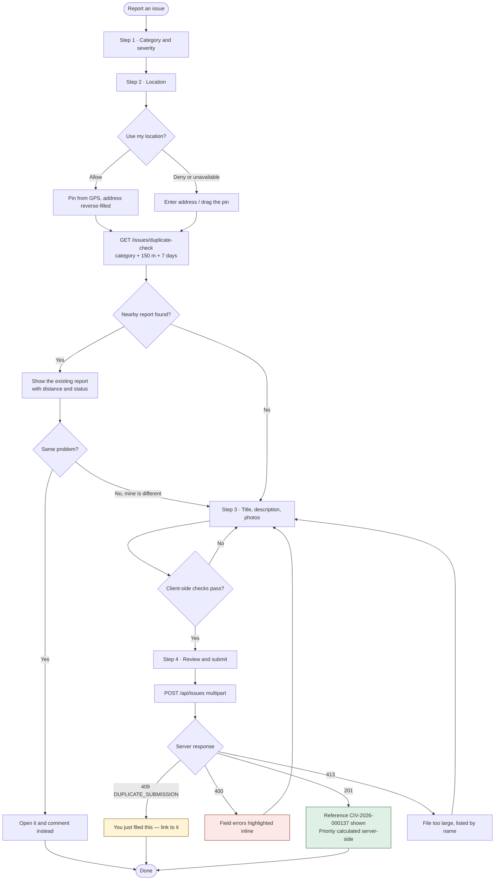
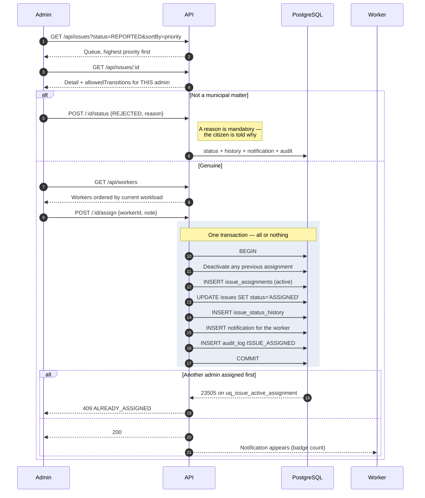
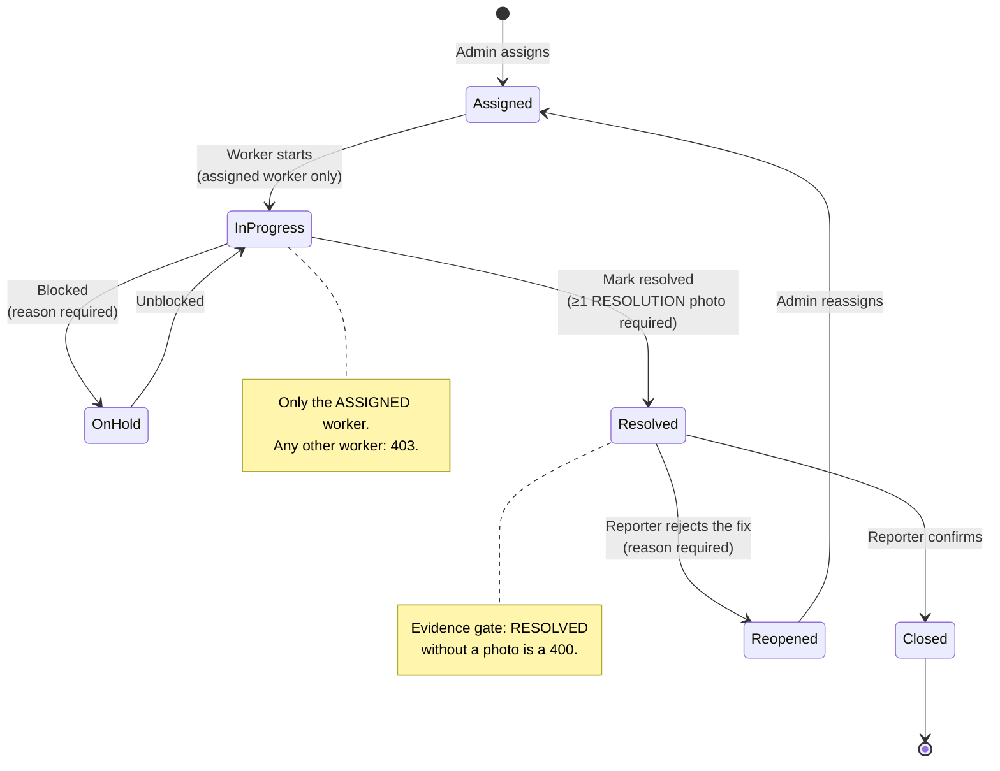
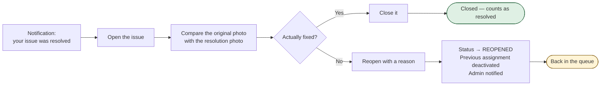
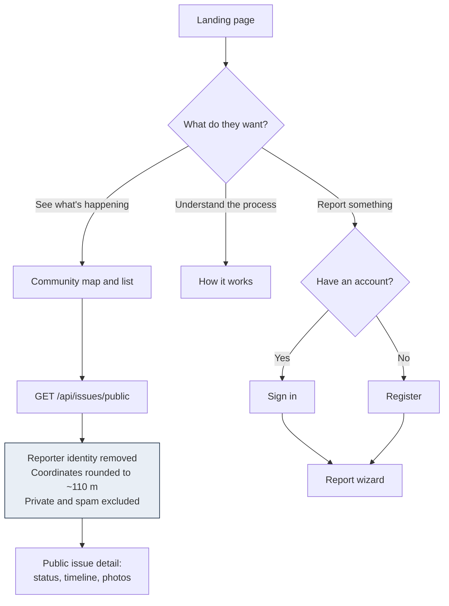
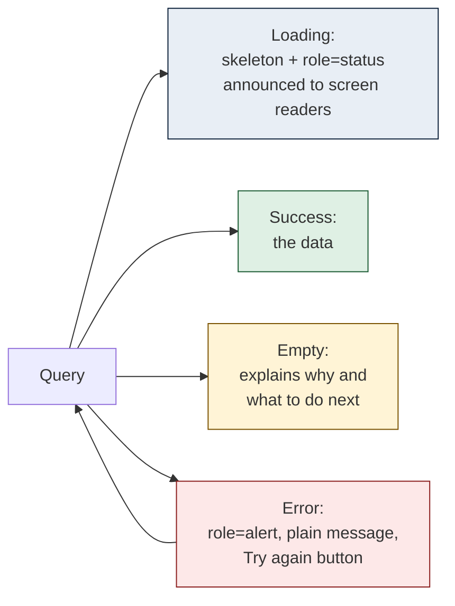

# User flows

How each role actually uses the system, with the decision points and failure
paths that matter. Diagrams are Mermaid and render on GitHub.

---

## Roles at a glance



---

## 1. Registration and sign-in

```mermaid
sequenceDiagram
    autonumber
    participant B as Browser (SPA)
    participant A as API
    participant D as PostgreSQL

    B->>A: GET /api/auth/csrf
    A-->>B: Set-Cookie civic_csrf (readable by JS)

    B->>A: POST /api/auth/register {name,email,password}<br/>X-CSRF-Token
    A->>A: Zod validation (12+ chars, mixed case, digit, symbol)
    A->>D: SELECT 1 FROM users WHERE email = $1
    alt Address already registered
        A-->>B: 409 EMAIL_ALREADY_REGISTERED
    else New address
        A->>A: Argon2id hash (19 MiB, t=2)
        A->>D: INSERT user (role forced to CITIZEN)
        A->>D: INSERT refresh_token (SHA-256 hash, new family)
        A->>D: INSERT audit_log USER_REGISTERED
        A-->>B: 201 + Set-Cookie civic_access, civic_refresh<br/>civic_csrf rotated
    end

    Note over B,A: 15 minutes later the access cookie expires

    B->>A: GET /api/issues
    A-->>B: 401 UNAUTHENTICATED
    B->>A: POST /api/auth/refresh (single-flight)
    A->>D: Look up token by hash; rotate
    alt Token already used → theft
        A->>D: Revoke entire family
        A-->>B: 401 REFRESH_TOKEN_INVALID
        B->>B: Clear state, redirect to /login
    else Valid
        A-->>B: 200 + new access & refresh cookies
        B->>A: GET /api/issues (replayed automatically)
        A-->>B: 200
    end
```

The role is never taken from the request. Registration always produces a
`CITIZEN`; staff accounts are created by an admin through `POST /users`.

---

## 2. Citizen: reporting an issue

The wizard is four steps so that the location step can do real work — asking for
geolocation, showing the pin, and checking for duplicates — without burying it
in a long form.



Duplicate detection **advises**, it does not block. Two people reporting the same
pothole is signal that it is worse than one report suggests — the second report
raises the priority score rather than being discarded. Only an *identical*
resubmission by the *same* reporter within a few minutes is refused, because
that is a double-clicked submit button.

---

## 3. Admin: triage and assignment



The partial unique index `uq_issue_active_assignment` is what makes concurrency
safe: two admins assigning the same issue at the same instant cannot both
succeed. The loser gets a clean 409 instead of the issue silently ending up with
two owners.

---

## 4. Worker: doing the job



The evidence gate is a process control as much as a technical one. "Mark as
done" with no proof is how a maintenance backlog becomes fiction; requiring a
photograph means the citizen can see the repair, and a reopened issue has a
before-and-after record attached to it.

Worker screens are built for a phone at a roadside: large tap targets, the
photograph capture as the primary action, and every list showing status as text
and shape, not colour alone.

---

## 5. Citizen: closing the loop



Only the reporter (or an admin) can close. A worker marking their own work as
finished-and-accepted would defeat the point of the confirmation step.

Entering `REOPENED` deactivates the active assignment. Without that, the partial
unique index would block reassignment and the issue would be stuck — a bug found
and fixed during smoke testing, and now covered by an explicit regression test.

---

## 6. Anonymous visitor



The public feed is the privacy-sensitive surface. A report is a statement that
someone was at a particular place and cared about it; exact coordinates plus a
name would be enough to infer home addresses and routines. So the anonymous feed
carries no reporter identity and rounds coordinates to three decimal places
(~110 m) — precise enough to show a neighbourhood problem, too coarse to
identify a doorstep. Signed-in staff see full precision because they have to go
and fix it.

---

## 7. Every screen's four states

Each list and detail view handles all four explicitly. There is no state in
which the user is left looking at a blank rectangle wondering whether it is
broken.



Empty states are written for the situation, not generically: a brand-new
citizen's dashboard says something different from a filtered admin list that
matched nothing, because the useful next action is different.

---

## 8. Notifications

Generated inside the same transaction as the event that caused them, so a
notification can never exist for something that did not happen, nor be missing
for something that did.

| Event | Who is notified |
| --- | --- |
| Issue assigned | The worker |
| Status changed | The reporter |
| Comment added (not internal) | The reporter, and the assigned worker |
| Issue resolved | The reporter — prompting confirm or reopen |
| Issue reopened | The admins, and the previously assigned worker |

Each links straight to the issue. The unread count comes from
`GET /api/notifications/unread-count` and is invalidated by React Query when
anything relevant changes, so the badge is live rather than a stale number from
page load.

---

## Accessibility notes

Applied throughout, not bolted on:

- Semantic landmarks (`header`, `nav`, `main`, `footer`), one `h1` per page, and
  a "Skip to content" link as the first focusable element.
- Every input has a real `<label>`; errors are wired with `aria-invalid` and
  `aria-describedby` and announced via `role="alert"`.
- Status is conveyed by **text plus shape**, never colour alone — the same badge
  is legible in greyscale.
- Full keyboard operation, visible focus rings, and focus trapped in modals with
  Escape to close and focus returned to the trigger.
- Loading regions use `role="status"` with `aria-live="polite"`, so a screen
  reader user is told the page is working rather than hearing silence.
- Photographs carry meaningful alt text describing the issue and image type.
- Contrast meets WCAG AA against the navy/amber palette.
- Layout is responsive from 320 px upwards, tested down to a small phone, with
  tap targets sized for a gloved hand at a roadside.
